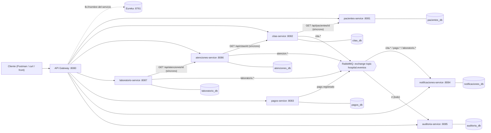
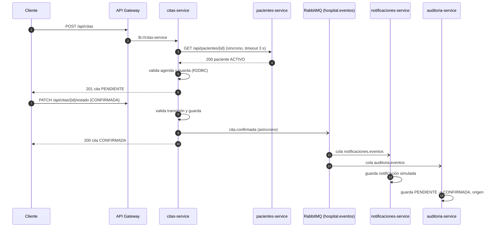
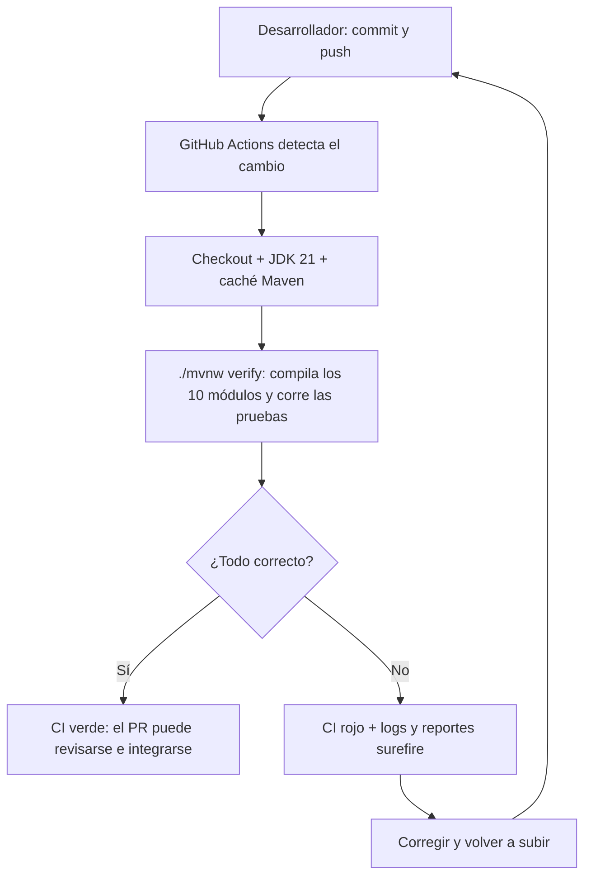

# Hospital Vida Salud – Documento técnico

> Proyecto académico T2. Todos los datos son **ficticios**. El sistema no diagnostica ni recomienda tratamientos.

## 1. Problema y alcance

El hospital opera un monolito que concentra pacientes, citas, atención, laboratorio, pagos, notificaciones y reportes.
Eso provoca alto acoplamiento, despliegues riesgosos, imposibilidad de escalar módulos por separado y efectos colaterales
cuando una parte falla.

**Solución:** plataforma administrativa distribuida con microservicios, un único punto de entrada (Gateway), descubrimiento
dinámico (Eureka), eventos asíncronos (RabbitMQ), persistencia SQL reactiva (R2DBC) e integración continua (GitHub Actions).

**Implementado** (flujo completo extremo a extremo): Pacientes, Citas (con reprogramación), Atenciones, Laboratorio, Pagos,
Notificaciones y Auditoría.
**Fuera de alcance** (opcionales en el enunciado): Hospitalización y Farmacia. Se excluyen porque no son necesarios para el flujo
mínimo exigido y añadirlos "por cantidad" sería una división artificial; la arquitectura permite incorporarlos como nuevos
servicios sin tocar los existentes (basta registrar la ruta en el Gateway y, si aplica, escuchar eventos).

## 2. Análisis del negocio

### 2.1 Actores

| Actor | Interacción con el sistema |
|---|---|
| Paciente | Recibe avisos de citas y pagos |
| Personal de admisión | Registra pacientes; programa, confirma, reprograma y cancela citas |
| Personal de salud | Registra la atención administrativa ligada a una cita confirmada |
| Laboratorio | Cambia el estado de solicitudes y registra resultados ficticios |
| Caja / administración | Registra pagos simulados |
| Administrador del sistema | Supervisa servicios (panel de Eureka, RabbitMQ, `/actuator/health`) y consulta auditoría |
| Equipo de desarrollo | Mantiene el código y el pipeline de CI |

### 2.2 Reglas de negocio y dónde se aplican

| Regla | Servicio | Implementación | Respuesta |
|---|---|---|---|
| Documento (tipo + número) no se duplica | pacientes | `PacienteService.validarDocumentoLibre` + restricción `UNIQUE` en BD | 409 |
| Solo pacientes ACTIVOS pueden tener citas | citas | `CitaService.crear` (consulta síncrona a pacientes) | 422 |
| Estados y transiciones de la cita | citas | `EstadoCita.puedeTransicionarA` | 422 |
| Profesional/paciente sin dos citas en el mismo horario | citas | Validación por consulta **+** índices únicos parciales en PostgreSQL | 409 |
| Solo se reprograman citas PENDIENTE o CONFIRMADA | citas | `EstadoCita.admiteReprogramacion` | 422 |
| Fecha de cita futura | citas | `@Future` en `CitaRequest` / `ReprogramarRequest` | 400 |
| Atención solo sobre cita CONFIRMADA y una atención vigente por cita | atenciones | `AtencionService.crear` + índice único parcial | 422 / 409 |
| Solicitud de laboratorio exige atención existente y no anulada | laboratorio | `SolicitudService.crear` (consulta síncrona a atenciones) | 404 / 422 |
| Resultado ficticio obligatorio al completar | laboratorio | `SolicitudService.cambiarEstado` | 422 |
| Pago con monto > 0 y número de operación único | pagos | `@Positive`, validación de servicio, `CHECK` y `UNIQUE` en BD | 400 / 409 |
| Todo cambio importante deja rastro y publica evento | todos los que mutan estado | `EventoPublisher` → auditoría | – |

## 3. Microservicios y límites de dominio

Criterio de división: **un servicio por capacidad de negocio con datos propios y ciclo de vida independiente**.
Notificaciones y auditoría son transversales y reaccionan a eventos, por lo que no pueden bloquear a los servicios de negocio.

| Servicio | Puerto | Base de datos | Entidad propia | Publica | Consume | Llama (síncrono) a |
|---|---|---|---|---|---|---|
| `api-gateway` | 8080 | – | – | – | – | todos (rutas `lb://`) |
| `eureka-server` | 8761 | – | registro de instancias | – | – | – |
| `pacientes-service` | 8081 | `pacientes_db` | `paciente` | – | – | – |
| `citas-service` | 8082 | `citas_db` | `cita` | `cita.*` | – | pacientes |
| `atenciones-service` | 8086 | `atenciones_db` | `atencion` | `atencion.*` | – | citas |
| `laboratorio-service` | 8087 | `laboratorio_db` | `solicitud_laboratorio` | `laboratorio.*` | – | atenciones |
| `pagos-service` | 8083 | `pagos_db` | `pago` | `pago.registrado` | – | – |
| `notificaciones-service` | 8084 | `notificaciones_db` | `notificacion` | – | `cita.*`, `pago.*`, `laboratorio.*` | – |
| `auditoria-service` | 8085 | `auditoria_db` | `registro_auditoria` | – | `#` (todos) | – |
| `hospital-common` | – | – | (biblioteca) contrato del evento, errores, publicador | – | – | – |

**Propiedad de los datos:** solo el servicio dueño escribe en sus tablas. Las referencias entre servicios
(`paciente_id`, `cita_id`, `atencion_id`) son **identificadores sin clave foránea**; la integridad se garantiza con consultas
síncronas por contrato (sección 7). Hay una instancia PostgreSQL con una base por servicio solo por simplicidad académica;
ningún servicio accede a tablas ajenas.

## 4. Arquitectura



Todos los servicios (incluido el Gateway) se registran en Eureka; el diagrama omite esas flechas para no saturarlo.

### 4.1 Diagrama de comunicación: cita confirmada



## 5. Gateway, Eureka, RabbitMQ y programación reactiva

**Spring Cloud Gateway.** Es el único punto de entrada (`/api/**`). Cada ruta apunta a `lb://<nombre-del-servicio>`.
Los clientes no deben depender de los puertos internos porque (a) los puertos y las IP cambian al escalar o redesplegar,
(b) se obtiene un único lugar para aplicar seguridad, límites y trazabilidad, y (c) los servicios pueden reubicarse o duplicarse
sin que el cliente lo note. El endpoint de actuator `gateway` no se expone, para que nadie pueda alterar rutas.

**Eureka.** Cada servicio se registra con su `spring.application.name`. Para localizar una instancia, el Gateway (o un
`WebClient` con `@LoadBalanced`) toma el nombre lógico, consulta la copia local del registro de Eureka, obtiene las instancias
sanas y el balanceador del lado del cliente elige una (round-robin). Si una instancia cae, deja de renovar su registro y se
retira de la lista.

**RabbitMQ.** Un exchange `topic` durable (`hospital.eventos`). Los productores publican con una routing key
`<recurso>.<estado>` y **no conocen a los consumidores**; cada consumidor declara su propia cola y sus *bindings*. Así se agregan
consumidores sin modificar a los productores (desacoplamiento).

**WebFlux + R2DBC.** Todos los servicios de negocio usan controladores `Mono`/`Flux`, repositorios `ReactiveCrudRepository`
y el driver `r2dbc-postgresql`; no hay JDBC. Las llamadas entre servicios usan `WebClient`. Aporta valor donde hay espera de E/S
(BD y otros servicios): pocos hilos atienden muchas solicitudes concurrentes, útil en horas de alta afluencia de citas.
`Mono` modela cero-o-uno (obtener por id, crear), `Flux` modela secuencias (listados, historial).
El único `block()` está en los *listeners* de RabbitMQ, que corren en el hilo propio del contenedor de mensajería (no en el pipeline
WebFlux) y permiten confirmar el mensaje solo si se guardó correctamente. El publicador de eventos mueve la API bloqueante de
Spring AMQP al scheduler `boundedElastic` para no bloquear el hilo reactivo.

## 6. Endpoints principales (siempre vía Gateway `:8080`)

| Servicio | Método y ruta | Descripción |
|---|---|---|
| pacientes | `POST /api/pacientes` | Registra (409 si el documento ya existe) |
| | `GET /api/pacientes/{id}` · `GET /api/pacientes` | Consulta (404 si no existe) |
| | `PUT /api/pacientes/{id}` | Actualiza (valida duplicado si cambia el documento) |
| | `PATCH /api/pacientes/{id}/estado?valor=ACTIVO\|INACTIVO` | Cambia el estado |
| citas | `POST /api/citas` | Programa (valida paciente y agenda) |
| | `GET /api/citas/{id}` · `GET /api/citas?pacienteId=` | Consulta |
| | `PATCH /api/citas/{id}/estado` `{"estado":"CONFIRMADA"}` | Cambia estado con transiciones válidas |
| | `PATCH /api/citas/{id}/reprogramar` `{"fechaHora":"…","profesionalCodigo":"…"}` | Reprograma (profesional opcional) |
| atenciones | `POST /api/atenciones` `{"citaId":1,"area":"…"}` | Requiere cita CONFIRMADA |
| | `GET /api/atenciones/{id}` · `GET /api/atenciones?pacienteId=` | Consulta |
| | `PATCH /api/atenciones/{id}/estado` | REGISTRADA → FINALIZADA \| ANULADA |
| laboratorio | `POST /api/laboratorio` `{"atencionId":1,"tipoExamen":"…"}` | Solicitud ficticia |
| | `GET /api/laboratorio/{id}` · `GET /api/laboratorio?pacienteId=` | Consulta |
| | `PATCH /api/laboratorio/{id}/estado` `{"estado":"…","resultadoFicticio":"…"}` | Resultado obligatorio al completar |
| pagos | `POST /api/pagos` | Monto > 0 y operación única |
| | `GET /api/pagos/{id}` · `GET /api/pagos?pacienteId=` | Consulta |
| notificaciones | `GET /api/notificaciones?pacienteId=` | Notificaciones generadas |
| auditoría | `GET /api/auditoria` · `GET /api/auditoria/{recurso}/{id}` | Historial de cambios |

**Formato de error único** (`hospital-common`): `{timestamp, status, error, mensaje}`.

| Código | Significado |
|---|---|
| 400 | Datos inválidos (validación de campos, cuerpo ilegible) |
| 404 | Recurso inexistente |
| 409 | Conflicto (documento, número de operación, horario o atención duplicados) |
| 422 | Regla de negocio violada (transición no permitida, cita no confirmada, etc.) |
| 503 | Un servicio del que se depende no está disponible |

### Estados y transiciones

| Recurso | Transiciones permitidas |
|---|---|
| Cita | PENDIENTE → CONFIRMADA \| CANCELADA · CONFIRMADA → ATENDIDA \| AUSENTE \| CANCELADA · el resto son finales |
| Atención | REGISTRADA → FINALIZADA \| ANULADA |
| Laboratorio | SOLICITADO → EN_PROCESO \| CANCELADO · EN_PROCESO → COMPLETADO \| CANCELADO |
| Paciente | ACTIVO ⇄ INACTIVO |

## 7. Comunicación síncrona: contratos

| Llamada | Contrato | Errores | Timeout / indisponibilidad |
|---|---|---|---|
| citas → pacientes | `GET /api/pacientes/{id}` → 200 con el paciente | 404 → 404 al cliente | 3 s, sin reintentos; caída o timeout → **503** |
| atenciones → citas | `GET /api/citas/{id}` → 200 | 404 → 404 al cliente | ídem |
| laboratorio → atenciones | `GET /api/atenciones/{id}` → 200 | 404 → 404 al cliente | ídem |

**Por qué síncrono aquí:** el cliente necesita saber *ahora* si la referencia es válida para aceptar o rechazar la operación.
Si el servicio dependiente no responde, se falla rápido con 503 en lugar de dejar la solicitud colgada o crear un dato inconsistente.

## 8. Comunicación asíncrona: eventos

**Exchange:** `hospital.eventos` (topic, durable). **Contrato** (`EventoNegocio`, sin datos personales):

```json
{ "recurso": "CITA", "recursoId": 1, "pacienteId": 1, "estadoAnterior": "PENDIENTE",
  "estadoNuevo": "CONFIRMADA", "origen": "citas-service", "fecha": "2030-01-15T10:00:00Z", "detalle": null }
```

`detalle` es opcional (p. ej. `"REPROGRAMADA"`, cuando la cita cambia de fecha pero conserva el estado).

| Routing key | Productor | Cola → consumidor |
|---|---|---|
| `cita.pendiente` · `cita.confirmada` · `cita.cancelada` · `cita.atendida` · `cita.ausente` | citas | `notificaciones.eventos` (binding `cita.*`) y `auditoria.eventos` (`#`) |
| `cita.reprogramada` | citas | ídem |
| `pago.registrado` | pagos | `notificaciones.eventos` (`pago.*`) y `auditoria.eventos` |
| `laboratorio.solicitado` · `.en_proceso` · `.completado` · `.cancelado` | laboratorio | `notificaciones.eventos` (`laboratorio.*`) y `auditoria.eventos` |
| `atencion.registrada` · `.finalizada` · `.anulada` | atenciones | `auditoria.eventos` |

**Por qué asíncrono:** notificar y auditar son procesos secundarios; el usuario no debe esperar ni depender de ellos. Si
notificaciones o auditoría están caídos, el cambio de estado igual se completa y los mensajes quedan en la cola durable.
Los consumidores reintentan 3 veces ante fallos y luego descartan el mensaje (sin bucle infinito).

**Limitación conocida:** si RabbitMQ no está disponible al publicar, el evento se pierde (el cambio sí se guarda).
Mejora propuesta: patrón *Outbox*.

## 9. Diseño de datos

Cada servicio define su esquema en `src/main/resources/schema.sql` (R2DBC lo ejecuta al iniciar). Claves, restricciones e índices relevantes:

| Tabla | Clave / restricciones | Índices |
|---|---|---|
| `paciente` | PK `id`; `UNIQUE(tipo_documento, numero_documento)` | – |
| `cita` | PK `id`; `codigo UNIQUE`; campos obligatorios `NOT NULL` | `(paciente_id)`, `(profesional_codigo, fecha_hora)`; **únicos parciales** (PostgreSQL) sobre profesional+horario y paciente+horario cuando `estado <> 'CANCELADA'` |
| `atencion` | PK `id`; `codigo UNIQUE` | `(cita_id)`, `(paciente_id)`; **único parcial** `cita_id` cuando `estado <> 'ANULADA'` |
| `solicitud_laboratorio` | PK `id`; `codigo UNIQUE`; `resultado_ficticio` opcional | `(atencion_id)`, `(paciente_id)` |
| `pago` | PK `id`; `CHECK (monto > 0)`; `numero_operacion UNIQUE` | `(paciente_id)` |
| `notificacion` | PK `id` | por paciente |
| `registro_auditoria` | PK `id`; `detalle` opcional | `(recurso, recurso_id)` |

Los índices únicos parciales cierran la condición de carrera de "consultar y luego insertar": aunque dos solicitudes
simultáneas pasen la validación por consulta, la base rechaza la segunda (se traduce a 409).

## 10. Seguridad, privacidad y datos de prueba

- Solo datos ficticios; los eventos y las notificaciones **no** contienen datos personales (solo identificadores y estados).
- Credenciales por variables de entorno (`.env` no se versiona; se incluye `.env.example`). Sin secretos en el repositorio ni en el workflow.
- Actuator expone solo `health` e `info`.
- **Mejora documentada:** autenticación/autorización en el Gateway (JWT/OAuth2) y TLS entre servicios.

## 11. Pruebas automatizadas

Se ejecutan con `./mvnw verify` y **no requieren Docker ni RabbitMQ** (H2 en memoria vía R2DBC, y mocks de clientes y broker).

| Prueba obligatoria del enunciado | Dónde se cubre |
|---|---|
| Registro de paciente válido | `PacienteServiceTest.registraPacienteValido`, `PacienteControllerTest.registraYConsultaPaciente` |
| Rechazo de paciente duplicado | `PacienteServiceTest.rechazaPacienteDuplicado`, `PacienteControllerTest.rechazaPacienteDuplicadoConConflicto` |
| Registro y consulta de cita | `CitaControllerTest.registraConsultaYConfirmaCita`, `CitaServiceTest.creaCitaParaPacienteValidoYPublicaEvento` |
| Transición de estado no permitida | `EstadoCitaTest`, `CitaServiceTest.rechazaTransicionNoPermitida`, `CitaControllerTest.transicionNoPermitidaDevuelve422` |
| Reprogramación (regla y endpoint) | `CitaServiceTest.reprograma…/noReprograma…`, `CitaControllerTest.reprogram…` |
| Publicación de un evento | `EventoPublisherTest`, `CitaServiceTest` (verifica `cita.confirmada` / `cita.reprogramada`) |
| Consumo de un evento | `NotificacionListenerTest`, `NotificacionServiceTest`, `AuditoriaServiceTest` |
| Contrato JSON del evento | `EventoNegocioTest` |
| Monto de pago no permitido | `PagoServiceTest.rechazaMontoCero/Negativo`, `PagoControllerTest.montoCeroONegativoDevuelve400` |
| Recurso inexistente | `…InexistenteDevuelve404` en cada servicio |

## 12. Integración continua (GitHub Actions)

Archivo: `.github/workflows/ci.yml`. Se ejecuta en **cada push (cualquier rama)** y en **cada pull request hacia `main`**.



**Qué ocurre ante un fallo:** si la compilación o una sola prueba falla, `mvnw verify` termina con código distinto de cero,
el *job* queda en rojo y el PR muestra la verificación fallida. Con **protección de rama** (Settings → Branches → *Require status
checks to pass*) GitHub impide integrar a `main` un cambio defectuoso. Los reportes de surefire se publican como artefacto
(`reportes-surefire`) aunque el job falle. El ciclo demostrado (fallo controlado → corrección → verde) está en
[`GUIA_EVIDENCIAS.md`](GUIA_EVIDENCIAS.md).

## 13. Cómo ejecutar

Ver el [README](../README.md): `cp .env.example .env`, `docker compose up -d`, variables de entorno y `./mvnw -pl <módulo> spring-boot:run`.
Pruebas: `./mvnw verify`.

## 14. Decisiones y limitaciones

| Decisión | Motivo |
|---|---|
| Una BD por servicio sin claves foráneas entre ellas | Propiedad de datos y evolución independiente |
| Síncrono solo para validar referencias; asíncrono para notificar/auditar | Respuesta inmediata donde se necesita; desacoplamiento donde no |
| `cita.reprogramada` con `detalle` en lugar de un nuevo estado | La reprogramación es una operación, no un estado del ciclo de vida de la cita |
| Índices únicos parciales solo en PostgreSQL | H2 (pruebas) no los soporta; la validación por consulta sigue activa en ambos |
| Sin Hospitalización ni Farmacia | Opcionales; el flujo mínimo está completo sin división artificial |

Pendientes reconocidos: patrón Outbox, DLQ e idempotencia en consumidores, bloqueo optimista (`@Version`), validación de
paciente en pagos, autenticación en el Gateway y Dockerfiles por servicio.
